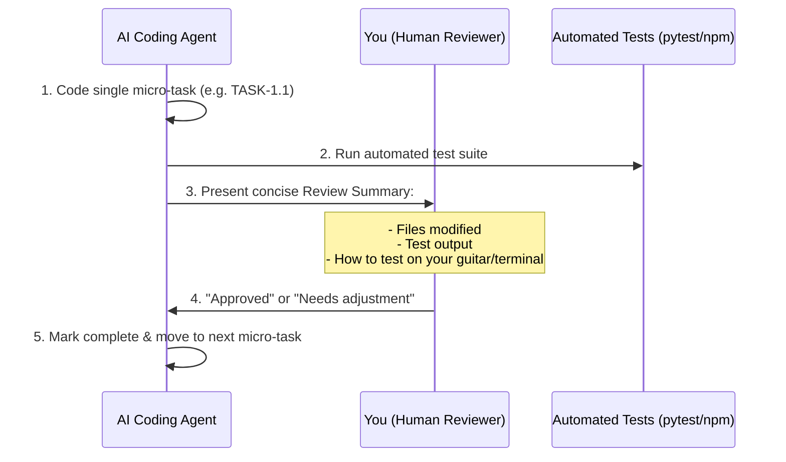
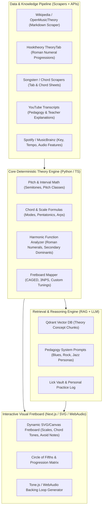
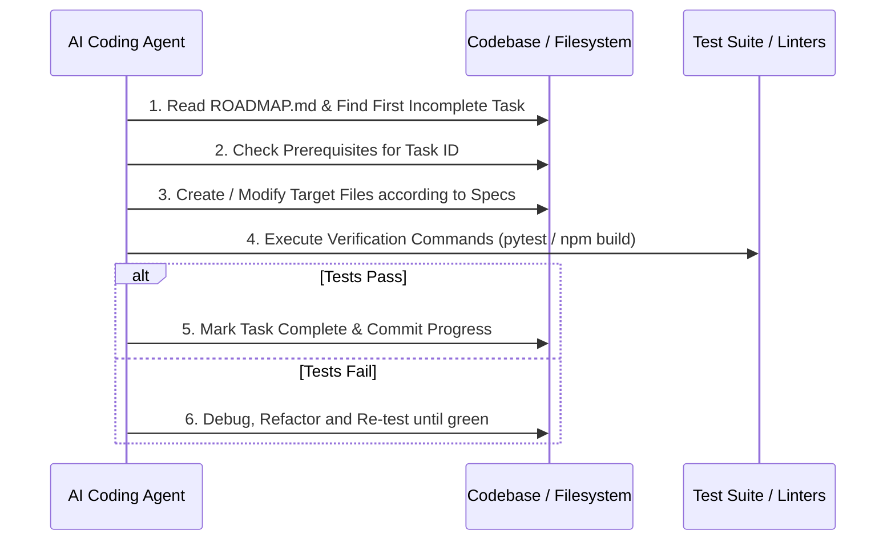

# 🎸 Guitar Theory Kingdom — 3-Month Execution Roadmap (Locked Scope)

> **Target Audience:** Autonomous AI Coding Agents, Human Developer (Aspiring Guitarist).  
> **Mission:** Build a high-precision, interactive music theory and practice companion for guitarists that solves real-time song analysis, fretboard navigation (CAGED/3NPS), modal interchange, and customized practice plans.  
> **Core Strategy:** **Micro-Task Driven Development.** Every milestone is decomposed into atomic units with automated tests, allowing for rapid, low-friction human review.  
> **Scope Agreement:** 
> - **3-Month Target (Phases 0–5):** Scrapers & Data $\rightarrow$ Deterministic Theory Engine $\rightarrow$ Interactive SVG Fretboard $\rightarrow$ Song Analysis $\rightarrow$ Local Vector RAG Coach $\rightarrow$ Backing Track & Speed Trainer.
> - **Post-MVP V2 (Phases 6–7):** Polyphonic Audio ML Transcriber & Custom LoRA Fine-Tuning.

---

## 🚦 Phase Overview & Current Execution Status

| Phase | Description | Micro-Tasks | Status |
|---|---|:---:|:---:|
| **Phase 0** | Workspace Scaffolding, Schemas & Seed Scrapers | 4 Micro-tasks | 🟡 In Progress |
| **Phase 1** | Deterministic Music Theory Engine (Pure Math & Algorithms) | 5 Micro-tasks | ⚪ Queued |
| **Phase 2** | Interactive SVG Fretboard & WebAudio Note Player | 5 Micro-tasks | ⚪ Queued |
| **Phase 3** | Song Metadata & Harmonic Progression Analyzer | 4 Micro-tasks | ⚪ Queued |
| **Phase 4** | Qdrant Local Vector RAG & Blues/Rock AI Coach | 4 Micro-tasks | ⚪ Queued |
| **Phase 5** | WebAudio Backing Track Engine & Speed Practice Tools | 4 Micro-tasks | ⚪ Queued |
| **Phase 6+7**| V2 Roadmap: Audio ML & Model Fine-Tuning | Deferred to V2 | ⏸️ Post-MVP |

---

## 🔬 Micro-Task Breakdown & Review Registry

### 🛠️ Phase 0: Workspace Scaffolding & Seed Data

- [x] **`TASK-0.1`**: Repository scaffolding (`backend/`, `frontend/`, `data/`), Python virtual environment config, `requirements.txt` with locked versions, and root `.gitignore`.
  * *Deliverable:* Project structure initialized and verified with clean python/node checks.
- [x] **`TASK-0.2`**: Theory Data Schemas (`Pydantic` models for Scales, Chords, Progressions, and CAGED Boxes).
  * *Deliverable:* `backend/app/schemas/theory.py` with serializable JSON models.
- [ ] **`TASK-0.3`**: Wikipedia & OpenMusicTheory Seed Harvester for core scales (Pentatonics, Blues, 7 Modes).
  * *Deliverable:* `data/processed/theory_seed.json` with 25+ verified musical structures.
- [ ] **`TASK-0.4`**: Standard Progressions Dataset (12-bar blues in multiple keys, ii-V-I, modal vamps).
  * *Deliverable:* `data/processed/progressions_seed.json`.

---

### 🧠 Phase 1: Deterministic Music Theory Engine (Python)

- [x] **`TASK-1.1`**: Pitch Class Algebra & Enharmonic Resolution (Chroma $0-11$, circle of fifths, accidental spellings $\sharp$ vs $\flat$).
  * *Deliverable:* `backend/app/theory/pitch.py` + `backend/tests/test_pitch.py` (100% test pass).
- [x] **`TASK-1.2`**: Interval Engine (Semitone distance, compound intervals, inversion math).
  * *Deliverable:* `backend/app/theory/intervals.py` + `backend/tests/test_intervals.py`.
- [x] **`TASK-1.3`**: Scale & Mode Generator (Major, Minor, Pentatonics, Blues, Modes, Phrygian Dominant).
  * *Deliverable:* `backend/app/theory/scales.py` + `backend/tests/test_scales.py`.
- [ ] **`TASK-1.4`**: Chord Formula & Quality Parser (Triads, 7ths, altered dominants, slash chords).
  * *Deliverable:* `backend/app/theory/chords.py` + `backend/tests/test_chords.py`.
- [ ] **`TASK-1.5`**: 24-Fret Guitar Matrix & CAGED 5-Box Position Engine (Standard & alternate tunings, 3NPS coordinates).
  * *Deliverable:* `backend/app/theory/fretboard.py` + `backend/tests/test_fretboard.py`.

---

### 🎨 Phase 2: Interactive SVG Fretboard & Web UI (Next.js 14)

- [ ] **`TASK-2.1`**: Next.js 14 App Router scaffolding, Tailwind CSS, Zustand global state store.
- [ ] **`TASK-2.2`**: SVG Fretboard Component with realistic fret spacing formula ($d_n = L \cdot (1 - 2^{-n/12})$) and fret inlay markers.
- [ ] **`TASK-2.3`**: Interactive Note Pins with display mode toggles (Note names vs Interval degrees).
- [ ] **`TASK-2.4`**: CAGED Box Bounding Box visual overlays and color-coded chord tone highlighting (Root, 3rd, 5th, 7th).
- [ ] **`TASK-2.5`**: Tone.js / WebAudio low-latency guitar pluck synthesizer on note click & chord strum preview.

---

### 🔍 Phase 3: Song Analysis & Harmonic Ingestion

- [ ] **`TASK-3.1`**: Spotify & MusicBrainz search API client (Key, Tempo, Time Signature, Audio Features).
- [ ] **`TASK-3.2`**: Chord chart parser (text chord sheet $\rightarrow$ structured progression).
- [ ] **`TASK-3.3`**: Key center detection algorithm (Krumhansl-Schmuckler harmonic weighting).
- [ ] **`TASK-3.4`**: Soloing Recommendation Engine (Given song chords $\rightarrow$ output best scales and target landing notes per bar).

---

### 🤖 Phase 4: Qdrant Local RAG & Guitar Coach

- [ ] **`TASK-4.1`**: Docker Compose setup for local Qdrant Vector DB + Python client ingestion script.
- [ ] **`TASK-4.2`**: Theory KB chunking and local embedding with `fastembed` (no external API cost).
- [ ] **`TASK-4.3`**: Blues/Rock Pedagogy System Prompt & RAG query endpoint ("Why does this change work?").
- [ ] **`TASK-4.4`**: Personal Lick Vault SQLite/Postgres backend + Frontend Lick Card component.

---

### 🎶 Phase 5: Backing Track Engine & Practice Tools

- [ ] **`TASK-5.1`**: Tone.js multi-track rhythm generator (Kick/Snare drum pattern + Walking/Root-Fifth Bass line).
- [ ] **`TASK-5.2`**: Harmonic Comping Synthesizer (plays progression chords in rhythm).
- [ ] **`TASK-5.3`**: Synchronized Fretboard Playhead (fretboard highlights update in real-time with the active bar/chord).
- [ ] **`TASK-5.4`**: Smart Practice Metronome & Speed Trainer (Accelerando $+2$ BPM loop, silent bar trainer).

---

## ⚡ Review & Execution Protocol for Each Micro-Task



---

## 🗺️ System Architecture & Agent Execution Topology



---

## 🚦 Phase Execution Overview

| Phase | Focus Area | Primary Deliverables | Immediate Practice Utility |
|---|---|---|---|
| **Phase 0** | Workspace & Seed Scraping | Clean scrapers for Wiki, OpenMusicTheory, Hooktheory; initial JSON theory schemas | Curated cheat sheets for blues & modes |
| **Phase 1** | Deterministic Music Theory Core | Python module: Interval math, chord spelling, scale generator, CAGED fretboard matrix | Instant command-line song/scale analyzer |
| **Phase 2** | Interactive Fretboard & Web UI | Next.js 14 + Tailwind + SVG interactive fretboard with audio clicks and scale overlays | Visual fretboard practice on your screen |
| **Phase 3** | Song Analysis & Ingestion Pipeline | Song lookup (Spotify + chords + theory engine harmonic analysis) | Search any song, get key, scales & soloing plan |
| **Phase 4** | Qdrant RAG & Persona Teachers | Local vector store + Ollama/OpenAI RAG pipeline with Blues/Rock teacher persona | "Why does this chord change work?" Q&A |
| **Phase 5** | Backing Track & Practice Engine | WebAudio / Tone.js backing track generator with MIDI export & metronome | Practice solos over dynamic rhythm backing |
| **Phase 6** | Audio ML & Ear Training | Basic Pitch / Librosa audio key/chord detection + ear training games | Transcribe solos and test your ear |
| **Phase 7** | Fine-Tuning & Model Factory | LoRA on curated guitar instruction QA pairs (Llama-3 / Mistral) | Specialized artist style AI tutor |

---

## 📋 Task Specification Standard for AI Agents

Every task block in this roadmap follows the **Agent Execution Contract**:
- `Task ID`: Unique tracking identifier.
- `Agent Role`: Specialist persona executing the task.
- `Prerequisites`: Required files or prior task IDs.
- `Target Files`: Exact paths to create or modify.
- `Specification`: Machine-readable description of functionality.
- `Verification & Tests`: Concrete shell command or automated test to prove completion.

---

## 🛠️ Phase 0: Workspace, Scrapers & Knowledge Curation

### `TASK-0.1: Project Monorepo Structure`
* **Agent Role:** System Architect
* **Prerequisites:** None
* **Target Files:**
  - `guitar-theory-kingdom/backend/pyproject.toml` or `requirements.txt`
  - `guitar-theory-kingdom/frontend/package.json`
  - `guitar-theory-kingdom/data/raw/`
  - `guitar-theory-kingdom/data/processed/`
  - `guitar-theory-kingdom/data/scrapers/`
  - `guitar-theory-kingdom/docker-compose.yml` (Qdrant + Postgres)
* **Specification:**
  Initialize the monorepo. Create standard Python virtual environment layout (`fastapi`, `uvicorn`, `pydantic`, `qdrant-client`, `requests`, `beautifulsoup4`, `pytest`). Setup Docker Compose for local Qdrant vector database (`port 6333`).
* **Verification & Tests:**
  ```bash
  python -m pytest backend/tests/
  docker compose up -d qdrant
  curl http://localhost:6333/readyz
  ```

---

### `TASK-0.2: OpenMusicTheory & Wikipedia Scraper`
* **Agent Role:** Data Ingestion Specialist
* **Prerequisites:** `TASK-0.1`
* **Target Files:**
  - `backend/scrapers/scrape_open_music_theory.py`
  - `backend/scrapers/scrape_wikipedia_scales.py`
  - `data/processed/theory_concepts.json`
* **Specification:**
  Extract structured public domain theory:
  1. Scales: Major, Minor (Natural, Harmonic, Melodic), Pentatonic, Blues, Modes (Ionian to Locrian).
  2. Chord formulas: Triads, 7ths, 9ths, 11ths, 13ths, altered dominants.
  3. Progressions: 12-bar blues, ii-V-I, I-vi-IV-V, Andalusian cadence.
  Save in standardized JSON schema:
  ```json
  {
    "id": "mixolydian_mode",
    "name": "Mixolydian Mode",
    "formula": [0, 2, 4, 5, 7, 9, 10],
    "intervals": ["1", "2", "3", "4", "5", "6", "b7"],
    "character_notes": ["3", "b7"],
    "common_contexts": ["Blues", "Classic Rock", "Dominant 7th chords"],
    "description": "..."
  }
  ```
* **Verification & Tests:**
  ```bash
  python backend/scrapers/scrape_wikipedia_scales.py
  python -c "import json; data=json.load(open('data/processed/theory_concepts.json')); assert len(data) >= 20; print(f'Successfully loaded {len(data)} concepts')"
  ```

---

### `TASK-0.3: Hooktheory & Progression Harvest Script`
* **Agent Role:** Data Ingestion Specialist
* **Prerequisites:** `TASK-0.1`
* **Target Files:**
  - `backend/scrapers/scrape_hooktheory_sample.py`
  - `data/processed/standard_progressions.json`
* **Specification:**
  Build a scraper/curator for standard rock/blues/pop progressions encoded in Roman Numerals:
  - 12-Bar Blues in E/A: `I7 - IV7 - I7 - V7 - IV7 - I7 - V7`
  - Modal Vamp: `I - bVII` (Mixolydian), `i - IV` (Dorian)
  - Minor Blues: `i - iv - i - V7alt - iv - i`
  Encode harmonic functions (Tonic, Subdominant, Dominant, Secondary Dominants).
* **Verification & Tests:**
  ```bash
  python backend/scrapers/scrape_hooktheory_sample.py
  python -c "import json; d=json.load(open('data/processed/standard_progressions.json')); assert '12_bar_blues' in d"
  ```

---

## 🧠 Phase 1: Deterministic Music Theory Engine

> **Rule for AI Agents:** NEVER use an LLM for deterministic math or note transposition. Always compute music theory algorithmically.

### `TASK-1.1: Pitch Class & Interval Calculator`
* **Agent Role:** Algorithm Engineer
* **Prerequisites:** `TASK-0.1`
* **Target Files:**
  - `backend/app/theory/pitch.py`
  - `backend/app/theory/intervals.py`
  - `backend/tests/test_pitch.py`
* **Specification:**
  Implement pitch class algebra:
  - Chroma mapping: $0 \rightarrow C, 1 \rightarrow C\sharp/D\flat, \dots, 11 \rightarrow B$.
  - Enharmonic resolution depending on key signature (e.g., in F Major, 10 is $B\flat$, not $A\sharp$).
  - Interval arithmetic: Transpose note by semitone delta; compute interval name (P1, m2, M2, m3, M3, P4, TT, P5, m6, M6, m7, M7, Octave).
* **Verification & Tests:**
  ```bash
  pytest backend/tests/test_pitch.py
  ```

---

### `TASK-1.2: Scale & Mode Generator`
* **Agent Role:** Algorithm Engineer
* **Prerequisites:** `TASK-1.1`
* **Target Files:**
  - `backend/app/theory/scales.py`
  - `backend/tests/test_scales.py`
* **Specification:**
  - Functions: `get_scale_notes(root: str, scale_type: str) -> list[str]`
  - Support: Major, Natural/Harmonic/Melodic Minor, Major/Minor Pentatonic, Blues Scale (with Blue note), 7 Church Modes, Dorian b2, Phrygian Dominant, Lydian Dominant, Whole Tone, Diminished.
  - Return interval degree metadata for each note (`1, b3, 4, b5, 5, b7`).
* **Verification & Tests:**
  ```python
  # Must satisfy:
  assert get_scale_notes("A", "minor_blues") == ["A", "C", "D", "Eb", "E", "G"]
  assert get_scale_notes("G", "mixolydian") == ["G", "A", "B", "C", "D", "E", "F"]
  ```

---

### `TASK-1.3: Chord Construction & Roman Numeral Analyzer`
* **Agent Role:** Algorithm Engineer
* **Prerequisites:** `TASK-1.1`, `TASK-1.2`
* **Target Files:**
  - `backend/app/theory/chords.py`
  - `backend/app/theory/harmony.py`
  - `backend/tests/test_chords.py`
* **Specification:**
  - Parse chord symbols: `Am7`, `Cmaj7`, `G7#9` (Hendrix chord), `F#m7b5`, `Dsus4`, `E7alt`.
  - Return chord tones with degree mapping: e.g., `G7#9` $\rightarrow$ `Root: G, 3rd: B, 5th: D, b7th: F, #9th: A#/Bb`.
  - Harmonic analysis: Given key and chord list, determine Roman numerals (e.g., Key C: `Dm7 - G7 - Cmaj7` $\rightarrow$ `ii7 - V7 - Imaj7`).
  - Modal interchange detection: Identify borrowed chords (e.g., `bVII` or `iv` in Major).
* **Verification & Tests:**
  ```bash
  pytest backend/tests/test_chords.py
  ```

---

### `TASK-1.4: Guitar Fretboard & CAGED System Engine`
* **Agent Role:** Guitar Pedagogy Specialist
* **Prerequisites:** `TASK-1.2`, `TASK-1.3`
* **Target Files:**
  - `backend/app/theory/fretboard.py`
  - `backend/tests/test_fretboard.py`
* **Specification:**
  - Support tunings: Standard `E-A-D-G-B-E`, Drop D, DADGAD, Open G.
  - Generate full 24-fret matrix with note coordinates `(string: 1-6, fret: 0-24)`.
  - **CAGED Engine**:
    - Calculate 5 CAGED box positions for any chord or scale.
    - Calculate 3-Notes-Per-String (3NPS) positions.
    - Flag chord tones (Root = Red, 3rd = Blue, 5th = Green, 7th = Yellow, Target Tension/Blue note = Orange).
* **Verification & Tests:**
  ```bash
  pytest backend/tests/test_fretboard.py
  ```

---

## 🎨 Phase 2: Interactive Fretboard & Frontend Prototype

### `TASK-2.1: Next.js 14 Setup & Component Library`
* **Agent Role:** Frontend Engineer
* **Prerequisites:** `TASK-0.1`
* **Target Files:**
  - `frontend/src/app/layout.tsx`
  - `frontend/src/app/page.tsx`
  - `frontend/src/components/ui/`
* **Specification:**
  Setup Next.js with App Router, Tailwind CSS, Lucide icons, and Zustand for state management (`currentKey`, `selectedScale`, `selectedChord`, `tuning`, `cagedPosition`).
* **Verification & Tests:**
  ```bash
  cd frontend && npm run build
  ```

---

### `TASK-2.2: Dynamic SVG Fretboard Component`
* **Agent Role:** Creative Technologist / Frontend Engineer
* **Prerequisites:** `TASK-2.1`, `TASK-1.4`
* **Target Files:**
  - `frontend/src/components/fretboard/Fretboard.tsx`
  - `frontend/src/components/fretboard/FretNote.tsx`
  - `frontend/src/components/fretboard/FretMarkers.tsx`
  - `frontend/src/types/fretboard.ts`
* **Specification:**
  Render a scalable, responsive SVG Guitar Neck (frets 0 to 22):
  - Correct fret spacing formula: $d_n = L \cdot (1 - 2^{-n/12})$.
  - Inlay markers at frets 3, 5, 7, 9, 12 (double), 15, 17, 19, 21.
  - Interactive note pins: Display Note Name or Interval (`R`, `b3`, `5`, etc.).
  - Color-coded highlights: Root, Chord Tones, Scale Tones, Avoid Notes.
  - CAGED Box bounding box overlay toggle.
  - Left-handed mode toggle.
* **Verification & Tests:**
  Verify visual rendering in browser; component unit test with `@testing-library/react`.

---

### `TASK-2.3: Audio Note Playback with WebAudio/Tone.js`
* **Agent Role:** Audio / Web Developer
* **Prerequisites:** `TASK-2.2`
* **Target Files:**
  - `frontend/src/lib/audio/synth.ts`
  - `frontend/src/hooks/useGuitarAudio.ts`
* **Specification:**
  - Synthesize plucked string timbre (Karplus-Strong algorithm or lightweight Soundfont sampler).
  - Clicking any fret note triggers immediate low-latency audio playback of the exact pitch and octave.
  - "Strum Chord" button to trigger notes sequentially with 30ms humanized strum delay.
* **Verification & Tests:**
  Browser click test producing audible pitch without console error.

---

## 🔍 Phase 3: Song Analysis & Ingestion Pipeline

### `TASK-3.1: Spotify & MusicBrainz Metadata Client`
* **Agent Role:** Backend Integration Engineer
* **Prerequisites:** `TASK-0.1`
* **Target Files:**
  - `backend/app/services/spotify_service.py`
  - `backend/app/services/musicbrainz_service.py`
  - `backend/app/api/endpoints/song.py`
* **Specification:**
  - Endpoint: `GET /api/song/search?q={query}`
  - Fetch: Track title, Artist, Album art, Tempo (BPM), Key signature, Time signature, Audio features (danceability, energy).
  - Fallback to MusicBrainz when Spotify credentials are not provided.
* **Verification & Tests:**
  ```bash
  pytest backend/tests/test_spotify_service.py
  ```

---

### `TASK-3.2: Chord Scraping & Harmonization Adapter`
* **Agent Role:** Backend Integration Engineer
* **Prerequisites:** `TASK-1.3`, `TASK-3.1`
* **Target Files:**
  - `backend/app/services/chord_scraper.py`
  - `backend/app/services/song_analyzer.py`
  - `backend/app/api/endpoints/analysis.py`
* **Specification:**
  - Ingest chord sequences from public chord sheet parsers (Ultimate Guitar / Songsterr / manual input).
  - Pipeline:
    1. Clean & normalize chord symbols.
    2. Detect tonal centers (Key identification algorithm: Krumhansl-Schmuckler key-finding or chord histogram score).
    3. Segment song into sections (Intro, Verse, Chorus, Solo).
    4. Provide recommended soloing scales for each section:
       - Example: Over `Am - D7` in A Dorian $\rightarrow$ Suggest A Minor Pentatonic, A Blues, A Dorian.
* **Verification & Tests:**
  ```bash
  python -m pytest backend/tests/test_song_analyzer.py
  ```

---

## 🤖 Phase 4: Vector RAG & Genre AI Teachers

### `TASK-4.1: Qdrant Vector Pipeline & Theory Embeddings`
* **Agent Role:** ML & Search Engineer
* **Prerequisites:** `TASK-0.2`, `TASK-0.3`
* **Target Files:**
  - `backend/app/rag/vector_store.py`
  - `backend/app/rag/embedder.py`
  - `backend/scripts/index_theory_kb.py`
* **Specification:**
  - Use `fastembed` (free, local, no API key needed) or `sentence-transformers` (`all-MiniLM-L6-v2`).
  - Chunk theory documents, chord progressions, and lick descriptions with metadata filters (`genre`, `difficulty`, `key`, `instrument`).
  - Index into Qdrant collection `guitar_theory_v1`.
* **Verification & Tests:**
  ```bash
  python backend/scripts/index_theory_kb.py
  python -c "from backend.app.rag.vector_store import search_kb; res = search_kb('how to solo over 12 bar blues'); assert len(res) > 0; print(res[0].payload['title'])"
  ```

---

### `TASK-4.2: Guitar Teacher Agent Personas`
* **Agent Role:** Prompt & Pedagogical Engineer
* **Prerequisites:** `TASK-4.1`, `TASK-1.4`
* **Target Files:**
  - `backend/app/teachers/prompts/blues_rock.py`
  - `backend/app/teachers/prompts/jazz_changes.py`
  - `backend/app/teachers/prompts/metal_shred.py`
  - `backend/app/teachers/advisor.py`
  - `backend/app/api/endpoints/teacher.py`
* **Specification:**
  - Implement RAG orchestration: When user requests advice on a progression, retrieve relevant theory chunks + fretboard diagrams.
  - Persona Prompt Constraints:
    - Must cite exact scale degrees and CAGED boxes.
    - Must explain target note resolution (e.g. "Land on the major 3rd $C\sharp$ when moving to the A7 chord").
    - Provide a concrete 3-step practice drill.
* **Verification & Tests:**
  ```bash
  pytest backend/tests/test_teacher_rag.py
  ```

---

### `TASK-4.3: Personal Lick Vault & Practice Journal`
* **Agent Role:** Full Stack Engineer
* **Prerequisites:** `TASK-1.4`, `TASK-2.2`
* **Target Files:**
  - `backend/app/models/lick.py`
  - `backend/app/api/endpoints/licks.py`
  - `frontend/src/components/vault/LickCard.tsx`
  - `frontend/src/components/vault/LickEditor.tsx`
* **Specification:**
  - Store personal guitar licks: Audio recording or tab snippet + Key + Target chord + CAGED box + Tags.
  - AI analysis: Inspect user lick and label chord degrees played.
  - Spaced repetition practice scheduler (SM-2 algorithm) for lick mastery.
* **Verification & Tests:**
  Verify CRUD operations via API and frontend UI.

---

## 🎶 Phase 5: Backing Track Generator & Practice Engine

### `TASK-5.1: WebAudio / Tone.js Backing Engine`
* **Agent Role:** Audio Web Engineer
* **Prerequisites:** `TASK-1.3`, `TASK-2.1`
* **Target Files:**
  - `frontend/src/lib/audio/backingTrack.ts`
  - `frontend/src/components/practice/BackingControls.tsx`
* **Specification:**
  - Input: Chord progression array (e.g., `["Am7", "Am7", "Dm7", "E7alt"]`), BPM, Groove (`Shuffle`, `Straight 8ths`, `Funk 16ths`).
  - Output: Synchronized audio rhythm track:
    - Bass line hitting roots & fifths on downbeats.
    - Drum kit (Kick, Snare, Hi-hat).
    - Guitar/Keyboard comping chords on backbeats.
  - Real-time active chord indicator that updates the SVG Fretboard highlighting as the track plays.
* **Verification & Tests:**
  Play/stop audio loop in browser without desync over 64 bars.

---

### `TASK-5.2: Speed Trainer & Smart Metronome`
* **Agent Role:** Frontend Audio Specialist
* **Prerequisites:** `TASK-5.1`
* **Target Files:**
  - `frontend/src/components/practice/SpeedTrainer.tsx`
  - `frontend/src/lib/audio/metronome.ts`
* **Specification:**
  - Accelerando mode: Automatically increase tempo by $+2$ or $+5$ BPM every $N$ bars.
  - Silent-bar mode: Mute click randomly on bars 3 and 4 to develop internal clock.
* **Verification & Tests:**
  Unit tests confirming WebAudio scheduling clock accuracy.

---

## 🔬 Phase 6: Audio Machine Learning & Transcriber

### `TASK-6.1: Basic Pitch & Polyphonic Audio Transcriber`
* **Agent Role:** Audio ML Specialist
* **Prerequisites:** `TASK-0.1`
* **Target Files:**
  - `backend/app/audio/transcribe.py`
  - `backend/tests/test_audio_transcribe.py`
* **Specification:**
  - Integrate Spotify's `basic-pitch` library (lightweight, runs on CPU/GPU without massive setups).
  - Accept audio upload (`.mp3`, `.wav`) $\rightarrow$ Output MIDI notes with start time, duration, and pitch.
  - Quantize notes to song grid using detected BPM from `librosa`.
* **Verification & Tests:**
  ```bash
  python -c "import basic_pitch; print('basic-pitch ready')"
  pytest backend/tests/test_audio_transcribe.py
  ```

---

## 🎯 Phase 7: Fine-Tuning & Model Specialization

### `TASK-7.1: Synthetic QA Generator for Guitar Instruction`
* **Agent Role:** AI Dataset Engineer
* **Prerequisites:** `TASK-0.2`, `TASK-4.1`
* **Target Files:**
  - `data/training/generate_qa_pairs.py`
  - `data/training/guitar_instruction_dataset.jsonl`
* **Specification:**
  - Generate 2,500 instruction-tuning pairs combining:
    - Progression + Key + Fretboard position $\rightarrow$ Soloing strategy.
    - Common mistakes $\rightarrow$ Diagnostic critique.
    - Artist styling (e.g., Stevie Ray Vaughan turnaround rules, David Gilmour bend targeting).
* **Verification & Tests:**
  ```bash
  python data/training/generate_qa_pairs.py --validate
  ```

---

### `TASK-7.2: QLoRA Fine-Tuning Pipeline`
* **Agent Role:** ML Infrastructure Engineer
* **Prerequisites:** `TASK-7.1`
* **Target Files:**
  - `backend/models/train_lora.py`
  - `backend/models/lora_config.yaml`
* **Specification:**
  - Fine-tune `unsloth/mistral-7b-instruct-v0.3-bnb-4bit` or `unsloth/llama-3-8b-bnb-4bit`.
  - Targets: `q_proj`, `k_proj`, `v_proj`, `o_proj`, `gate_proj`.
  - Run evaluation loss check and export merged GGUF for local Ollama serving.
* **Verification & Tests:**
  Test loss convergence below threshold and verify output GGUF loaded into Ollama.

---

## 📂 Master Directory & File Specification

Autonomous agents should create and populate the following project tree:

```
guitar-theory-kingdom/
├── backend/
│   ├── app/
│   │   ├── api/
│   │   │   ├── endpoints/
│   │   │   │   ├── analysis.py
│   │   │   │   ├── licks.py
│   │   │   │   ├── song.py
│   │   │   │   └── teacher.py
│   │   │   └── router.py
│   │   ├── audio/
│   │   │   └── transcribe.py
│   │   ├── rag/
│   │   │   ├── embedder.py
│   │   │   └── vector_store.py
│   │   ├── services/
│   │   │   ├── chord_scraper.py
│   │   │   ├── musicbrainz_service.py
│   │   │   ├── song_analyzer.py
│   │   │   └── spotify_service.py
│   │   ├── teachers/
│   │   │   ├── advisor.py
│   │   │   └── prompts/
│   │   │       ├── blues_rock.py
│   │   │       └── jazz_changes.py
│   │   └── theory/
│   │       ├── chords.py
│   │       ├── fretboard.py
│   │       ├── harmony.py
│   │       ├── intervals.py
│   │       ├── pitch.py
│   │       └── scales.py
│   ├── scrapers/
│   │   ├── scrape_hooktheory_sample.py
│   │   ├── scrape_open_music_theory.py
│   │   └── scrape_wikipedia_scales.py
│   ├── tests/
│   │   ├── test_chords.py
│   │   ├── test_fretboard.py
│   │   ├── test_pitch.py
│   │   └── test_scales.py
│   ├── main.py
│   └── requirements.txt
├── data/
│   ├── processed/
│   │   ├── standard_progressions.json
│   │   └── theory_concepts.json
│   └── raw/
├── frontend/
│   ├── src/
│   │   ├── app/
│   │   │   ├── layout.tsx
│   │   │   └── page.tsx
│   │   ├── components/
│   │   │   ├── fretboard/
│   │   │   │   ├── FretMarkers.tsx
│   │   │   │   ├── FretNote.tsx
│   │   │   │   └── Fretboard.tsx
│   │   ├── practice/
│   │   │   ├── BackingControls.tsx
│   │   │   └── SpeedTrainer.tsx
│   │   └── vault/
│   │       ├── LickCard.tsx
│   │       └── LickEditor.tsx
│   ├── hooks/
│   │   └── useGuitarAudio.ts
│   ├── lib/
│   │   └── audio/
│   │       ├── backingTrack.ts
│   │       ├── metronome.ts
│   │       └── synth.ts
│   ├── types/
│   │   ├── fretboard.ts
│   │   └── theory.ts
│   ├── package.json
│   └── tailwind.config.js
├── docker-compose.yml
├── Makefile
└── ROADMAP.md
```

---

## ⚡ Agent Action Protocol: Step-by-Step Execution Sequence

When an AI agent is instructed to start or continue work, it must follow this exact loop:



### Next Immediate Target for Agent Execution:
👉 **`TASK-0.1` & `TASK-1.1`**: Initialize repository files, install dependencies, and build the pitch class / interval calculator with complete unit tests.

